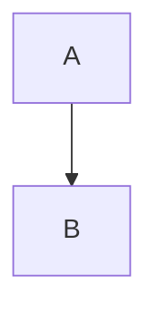

# probe


<svg/onload=window.__x2=1>
<iframe srcdoc="<script>parent.__x3=1</script>"></iframe>

[link1](javascript:window.__x4=1)


<details open><summary>md</summary>

**bold** `code`

</details>

<!-- comment:  -->

| a | b |
|---|---|
|  | x |

```html

```



<script>window.__x9=1</script>
